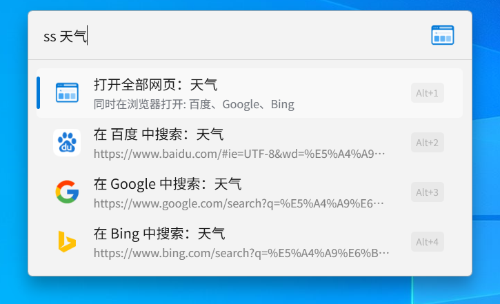
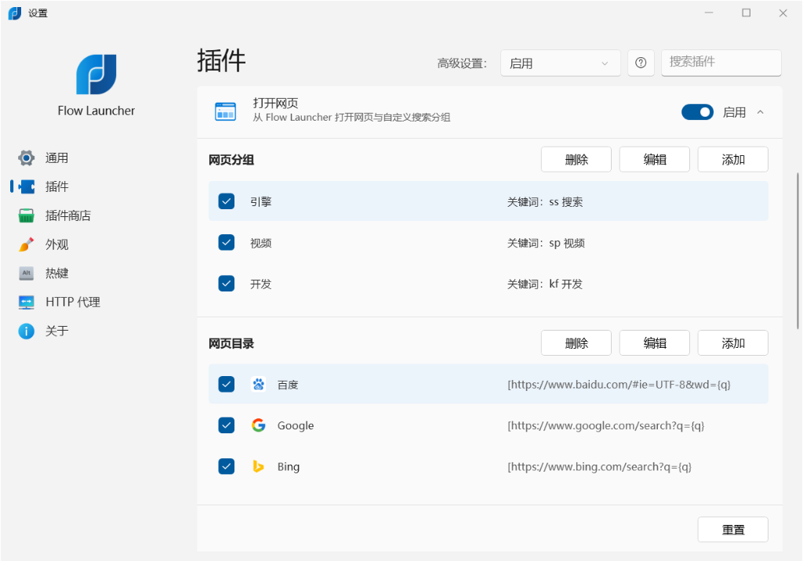

# Flow Launcher - GroupWebSearch

**极速网页多开与分组聚合搜索插件 | High-Speed Multi-Webpage & Group Search Plugin**

[简体中文](#-简体中文) • [English](#-english) • [日本語](#-日本語) • [Deutsch](#-deutsch)

---

## 📸 界面预览 / Screenshots

<table align="center" width="100%">
  <tr>
    <td align="center" width="50%">
      <b>🔍 搜索演示 / Search Demo</b>  
      
    </td>
    <td align="center" width="50%">
      <b>⚙️ 插件设置 / Plugin Settings</b>  
      
    </td>
  </tr>
  <tr>
    <td align="center" width="50%">
      <b>📁 分组设置 / Group Settings</b>  
      
    </td>
    <td align="center" width="50%">
      <b>🌐 网址与隐身 / URL & Incognito</b>  
      
    </td>
  </tr>
</table>

---

## 🇨🇳 简体中文

### 简介
**GroupWebSearch** 是专为 **[Flow Launcher](https://flowlauncher.com)** 打造的聚合搜索与网页分组直达插件。支持一键在多个搜索引擎（百度、Google、Bing 等）中并发打开关键词，也可独立打开任意单个引擎或常用网址，让信息检索快人一步。

### 功能特性
- ⚡ **一键全开**：支持一键在默认浏览器中同时打开分组下的所有网址并完成搜索。
- 🎯 **灵活分组**：支持在设置面板中任意添加“常用引擎”、“视频娱乐”、“开发文档”等分组并绑定自定义触发词。
- 🕶️ **隐私保护**：支持为指定网址开启“隐身模式”，无痕检索更安心。
- 🚀 **极速原生**：采用纯 C#（.NET 9.0 + WPF）开发，毫秒级响应，**无需安装 Python**。
- 🌍 **完整多语言**：深度适配官方 26 种系统语言，随系统自动切换。

### 安装方法
- **插件商店安装（推荐）**：  
  在 Flow Launcher 搜索框输入：`pm install GroupWebSearch`
- **离线安装**：  
  从 [Releases](https://github.com/ITOIOTI/Flow.Launcher.Plugin.GroupWebSearch/releases/latest) 下载 ZIP 解压至 `%APPDATA%\FlowLauncher\Plugins\` 目录并重启 Flow Launcher。

---

## 🇺🇸 English

### Overview
**GroupWebSearch** is a high-performance search aggregation and URL grouping plugin for **[Flow Launcher](https://flowlauncher.com)**. It allows you to search across multiple search engines (Google, Bing, Baidu, DuckDuckGo, etc.) simultaneously with a single click, or quickly open specific website bookmarks.

### Key Features
- ⚡ **Open All in One Click**: Instantly distribute your query across all configured engines in your group simultaneously.
- 🎯 **Custom Groups**: Freely create, edit, or delete URL groups (e.g., "Engines", "Videos", "Dev") with custom action keywords.
- 🕶️ **Incognito Mode**: Toggle private/incognito browsing individually for each search engine or website.
- 🚀 **Native Performance**: Built entirely with C# (.NET 9.0 + WPF). Blazing fast startup, **Zero Python dependency**.
- 🌍 **26 Languages**: Fully localized with support for 26 official Flow Launcher languages.

### Installation
- **In-App Store (Recommended)**:  
  Run `pm install GroupWebSearch` in Flow Launcher.
- **Manual Install**:  
  Download `Flow.Launcher.Plugin.GroupWebSearch.zip` from [Releases](https://github.com/ITOIOTI/Flow.Launcher.Plugin.GroupWebSearch/releases/latest), extract it to `%APPDATA%\FlowLauncher\Plugins\`, and restart Flow Launcher.

---

## 🇯🇵 日本語

### 概要
**GroupWebSearch** は、**[Flow Launcher](https://flowlauncher.com)** 向けの高速検索アグリゲーション＆ウェブサイトグループプラグインです。1回の入力で Google、Bing、Baidu などの複数の検索エンジンを同時にブラウザで開くことができます。

### 主な特徴
- ⚡ **一括検索**：グループ内のすべての検索エンジンで同時にキーワードを検索。
- 🎯 **自由なグループ管理**：「検索エンジン」「動画」「開発」など、好みのグループとキーワードを自由に作成・編集。
- 🕶️ **シークレットモード**：特定の検索エンジンでプライベートブラウジングを有効化可能。
- 🚀 **高速・軽量**：純粋な C# (.NET 9.0) 実装。**Python 不要**で即座に動作。

### インストール
- Flow Launcher の検索バーで `pm install GroupWebSearch` を実行。

---

## 🇩🇪 Deutsch

### Übersicht
**GroupWebSearch** ist ein leistungsstarkes Plugin für **[Flow Launcher](https://flowlauncher.com)** zur schnellen Gruppensuche und Website-Verwaltung. Durchsuchen Sie mehrere Suchmaschinen (Google, Bing, DuckDuckGo usw.) gleichzeitig mit nur einem Tastendruck.

### Highlights
- ⚡ **Alle auf einmal öffnen**: Durchsuchen Sie alle konfigurierten Suchmaschinen einer Gruppe gleichzeitig im Browser.
- 🎯 **Benutzerdefinierte Gruppen**: Beliebige Gruppen erstellen und mit individuellen Suchkürzeln verknüpfen.
- 🕶️ **Inkognito-Modus**: Privates Surfen für einzelne Suchmaschinen flexibel aktivierbar.
- 🚀 **Nativ & Schnell**: Entwickelt in nativem C# (.NET 9.0). **Keine Python-Installation erforderlich**.

### Installation
- Führen Sie in Flow Launcher einfach `pm install GroupWebSearch` aus.

---

## 📄 License

Distributed under the [MIT License](LICENSE).
